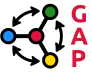
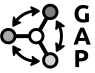
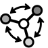

# GAP Logo proposal

This is the logo of the [GAP computer algebra system](https://www.gap-system.org).

Source code is (lua)latex using TiKZ, which produces a PDF that can then be converted to other formats
such as PNG. 

## Preview

### Light theme variant

&nbsp;&nbsp;&nbsp;&nbsp;&nbsp;&nbsp;&nbsp;&nbsp;&nbsp;

&nbsp;&nbsp;&nbsp;&nbsp;&nbsp;&nbsp;&nbsp;&nbsp;&nbsp;

### Dark theme variant

&nbsp;&nbsp;&nbsp;&nbsp;&nbsp;&nbsp;&nbsp;&nbsp;&nbsp;

&nbsp;&nbsp;&nbsp;&nbsp;&nbsp;&nbsp;&nbsp;&nbsp;&nbsp;

### Four color variant

&nbsp;&nbsp;&nbsp;&nbsp;&nbsp;&nbsp;&nbsp;&nbsp;&nbsp;

&nbsp;&nbsp;&nbsp;&nbsp;&nbsp;&nbsp;&nbsp;&nbsp;&nbsp;

### Gray variant

&nbsp;&nbsp;&nbsp;&nbsp;&nbsp;&nbsp;&nbsp;&nbsp;&nbsp;

&nbsp;&nbsp;&nbsp;&nbsp;&nbsp;&nbsp;&nbsp;&nbsp;&nbsp;

### Black & white variant

&nbsp;&nbsp;&nbsp;&nbsp;&nbsp;&nbsp;&nbsp;&nbsp;&nbsp;

&nbsp;&nbsp;&nbsp;&nbsp;&nbsp;&nbsp;&nbsp;&nbsp;&nbsp;

## Rationale

When developing this logo, I tried to keep some principle in mind.
First off, what *is* GAP? To quote the website:

> GAP is a system for computational discrete algebra, with particular emphasis on Computational Group Theory. GAP provides a programming language, a library of thousands of functions implementing algebraic algorithms written in the GAP language as well as large data libraries of algebraic objects. See also the overview and the description of the mathematical capabilities. GAP is used in research and teaching for studying groups and their representations, rings, vector spaces, algebras, combinatorial structures, and more. The system, including source, is distributed freely. You can study and easily modify or extend it for your special use.

GAP is for researchers and other experts. It is not for school level mathematics.

Then I did some brain storming:

- The core topic of GAP, "group theory", deals with symmetry.
    - the [wikipedia page on group theory](https://en.wikipedia.org/wiki/Group_theory) has some pictures related to this
    - [Wikipedia page on representation theory](https://en.wikipedia.org/wiki/Representation_theory)
    - Lots of nice geometry from e.g. Coxeter/reflection groups, e.g. [this one](https://sites.tufts.edu/verseimreu/files/2021/01/image.png)
    - [Dynkin diagrams](https://duckduckgo.com/?q=dynkin+diagram&t=osx&iax=images&ia=images) turn up everywhere, and classify [finite reflection groups](https://en.wikipedia.org/wiki/Reflection_group), which are archetypical for symmetry
    - [subgroup lattices can look great](https://duckduckgo.com/?q=subgroup+lattice&t=osx&iax=images&ia=images)

- If any mathematical "pictures" were to be included, it would be preferable if they were still recognizable by "many" mathematicans; so not things that are super specialized (this can of course be hard to judge...)

- GAP is free (you don't have to pay) and open source. That means everyone can "get the source code" and thus see how it work; and thus also modify it and extend it as they like.

It also was clear that some things should be avoided:

- shouldn't resemble the logo of the famous GAP fashion company
- no "math-y looking stuff" like Pi, crazy formulas with integrals etc -- it's not about that kind of math
- The name "GAP" is an acronym; it has nothing to do with a physical "gap", so playing on things like "mind the gap" is  not really appropriate either

Finally, there is an [existing unofficial logo](https://avatars.githubusercontent.com/u/5344223) that some people use for GAP -- but this is not official in any way, so there is obligation to e.g. reference its color scheme or shape. (Indeed, I was once told that it supposedly was inspired by certain ["mind the GAP" signs](https://en.wikipedia.org/wiki/Mind_the_gap#/media/File:Metro_North_gap_sign.jpg) which we want to avoid here)

## Explanation of the final design

The diagram in the left part is meant to indicate symmetry, here $S_3$ acting
on the leaf vertices of a symmetric graph, indicated by arrows suggesting
involutions swapping the leaves. The graph can also be interpreted as the
Dynkin diagram of type $D_3$, and then the group action is the triality
automorphism which plays an important role in algebriac Lie theory, finite
simple groups, geometry and more.

The letters GAP feature prominently and are arranged vertically. Since GAP is
also the name of a very famous fashion brand, I do not want them being
confused. The "GAP" text in the logo of the fashion company is always
horizontal, ours is vertical; they use a serif font, we use sans-serif; their
font is very narrow and tall, ours has almost square shapped letters.

In addition, in the full logo we spell out what the abbreviation GAP stands
for, which further prevents confusion, but also is helpful to convey clearly
what GAP is about. I also find the resulting look aesthetically pleasing, with
the gentle slope introduced by the increasing length of the words "Groups",
"Algorithms", and "Programming".

As font I chose the [Ubuntu Font](https://design.ubuntu.com/font/). It is
under a [liberal license](https://ubuntu.com/legal/font-licence) that is
compatible with the open source spirit of the GAP project. Its design blurb
states that it aims to "convey a precise, reliable and free attitude", which
of course fits well with GAP, and I happen to think it indeed achieves these
aims (but of course this is highly subjective).

But I wanted a no-frills sans-serif font with clean curves; I found the Ubuntu
font to be highly geometrical and it "fits" with the diagram part quite well.

I also experimented with using the mono spaced variant, "Ubuntu Mono", but in
the end found the look of the base font superior for our purposes.

## License

The GAP logo is © Max Horn and a trademark of the GAP project.

The logo licensed under [CC BY-SA 4.0](https://creativecommons.org/licenses/by-sa/4.0/).

### Academic & Educational Use Waiver

For uses in **academic, educational, or research contexts**, attribution is **not required** if it is clear from context that the logo refers to the GAP computer algebra system. Examples include:

- Scientific posters or presentations referencing GAP.
- Slides, lectures, or demonstrations in courses at any level (high school, university, workshops).
- Publications, articles, or tutorials discussing or teaching GAP.

In these cases, **the context itself counts as sufficient attribution**. The main goal is to ensure it is clear the logo represents GAP.

### General License Terms

Outside of the academic/educational contexts described above, the normal **CC BY-SA 4.0** terms apply:

- Attribution is required.
- Any derivatives must be shared under the same license.

For more details, see the official CC BY-SA 4.0 license: [https://creativecommons.org/licenses/by-sa/4.0/](https://creativecommons.org/licenses/by-sa/4.0/).
